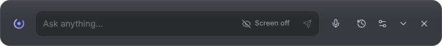
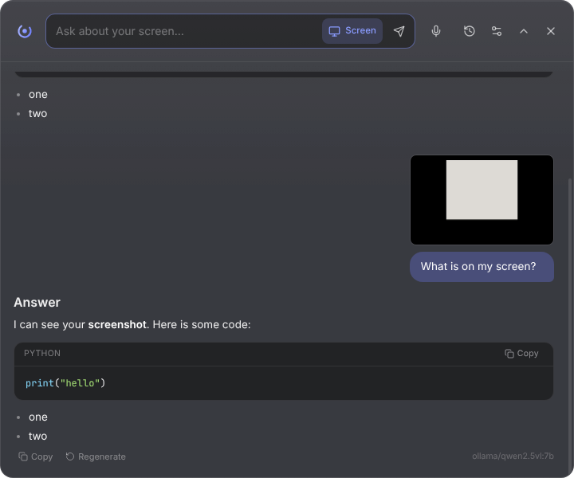
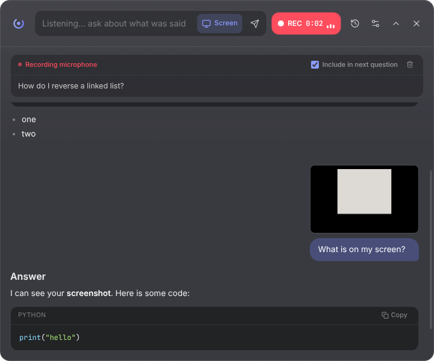
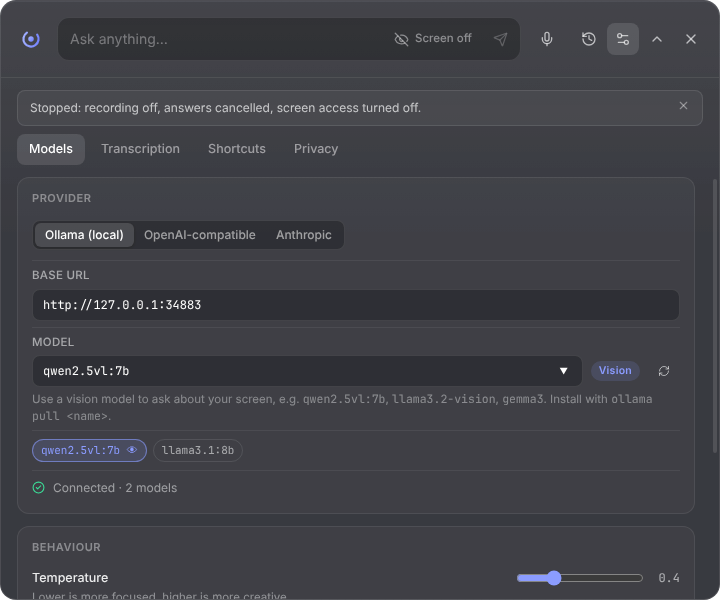

# OpenClue

**A transparent, local-first AI assistant that floats over your desktop.**
Ask questions, optionally attach a screenshot of what you're looking at, or bring in live
microphone transcription. Answers stream into a compact glass overlay. It runs on local models
through [Ollama](https://ollama.com) and [whisper.cpp](https://github.com/ggml-org/whisper.cpp)
by default, with optional OpenAI-compatible and Anthropic cloud providers.

There's no account, telemetry or analytics, and it doesn't run hidden.

<p align="center">
  
</p>

| Ask about your screen | Live transcription | Settings |
| --- | --- | --- |
|  |  |  |

> Screenshots were taken from the automated smoke test running under Xvfb. On macOS the
> panel sits on top of native "HUD" vibrancy, so it looks like darker frosted glass.

---

## Features

- **Floating overlay.** It's frameless, translucent, always on top and draggable from the logo. The window stays a compact command bar until you need more room, then it expands. It remembers where you put it.
- **Global hotkeys.** You can change all of them in Settings → Shortcuts, which has a click-to-record shortcut editor:
  | Action | Default (macOS) |
  | --- | --- |
  | Show / hide overlay | `⌘⇧Space` |
  | Ask about screen (one screenshot + ask) | `⌘⇧↩` |
  | Start / stop recording | `⌘⇧M` |
  | **Stop everything** (recording, answers, screen access) | `⌘⇧⌫` |
- **Keyboard-first.** `Enter` sends, `⌘Enter` sends with a screenshot, `⌘.` stops generating, `⌘K` starts a new chat, `⌘J` opens History, `⌘,` opens Settings, `⌘L` focuses the input. `Esc` steps back, then collapses, then hides.
- **Screen context with your consent.** Screenshots are refused by the main process until you turn screen access on. Capture happens only when you send a question with **Screen** on. There's never any background or continuous capture. The exact image that was sent appears in the conversation. Only the most recent screenshot goes to the model.
- **Live microphone transcription.** Audio is captured in 2–15 s chunks, near-silent chunks are skipped, and the rest go to Whisper. The text streams into a transcript strip. A red **REC** indicator with a timer and level meter is always shown. Audio is never written to disk, except for a temporary file for the whisper.cpp CLI, which is deleted right after.
- **Streaming answers** with GitHub-flavoured Markdown, tables, syntax highlighting and copy buttons. You can regenerate or retry an answer. Raw HTML is never rendered.
- **Providers:**
  - **Ollama** (default, local). It auto-detects installed models and their vision capability.
  - **OpenAI-compatible.** This covers OpenAI, OpenRouter, Groq, Together, LM Studio, vLLM, Gemini's OpenAI endpoint, and anything else that speaks `/chat/completions`.
  - **Anthropic** Messages API.
- **Whisper backends:** the whisper.cpp CLI (local), the whisper.cpp server (local), or any OpenAI-compatible `/audio/transcriptions` endpoint.
- **Conversation history** is saved locally as JSON. You can search it, delete single conversations or everything, and set a retention period. Screenshots aren't saved unless you opt in.
- **Secure by default:**
  - The renderer is sandboxed and context-isolated, with a strict CSP.
  - All network calls go through the main process.
  - API keys are encrypted with the macOS Keychain (`safeStorage`) and never reach the UI.
  - IPC sender validation is on.
  - Electron permissions are deny-by-default, with audio allowed only while the microphone is enabled.

## Transparency and what OpenClue will not do

OpenClue is a personal productivity tool and doesn't hide what it does:

- The overlay is **not** hidden from screen sharing, screenshots or proctoring software. It doesn't call `setContentProtection`. Anyone watching your screen can see it.
- It does **not** record in the background. Recording always shows a REC indicator in the overlay and a `● REC` label in the menu bar. macOS's own orange microphone indicator also appears. Pressing the mic shortcut always brings the overlay forward.
- Screen access and microphone access are separate opt-ins. Both have a consent dialog. The menu bar shows `Screen on` whenever screen access is enabled.
- **Stop everything** (button, menu-bar item, or `⌘⇧⌫`) stops the microphone and releases the hardware immediately. It also cancels in-flight answers and turns screen access off.
- When you choose a cloud provider, the UI says clearly that your data leaves the device.

Please don't use it where assistance isn't allowed, such as exams, proctored assessments or interviews that forbid it.

---

## Requirements

- macOS 12 or later, Apple Silicon or Intel. It also runs on Linux and Windows for development.
- Node.js 20+ and npm 10+.
- [Ollama](https://ollama.com/download) for local models.
- Optional: [whisper.cpp](https://github.com/ggml-org/whisper.cpp) for local transcription.

## Setup

### 1. Install and run

```bash
cd openclue
npm install
npm run dev          # starts Electron with hot reload
```

The overlay appears at the top of your screen. Press `⌘⇧Space` to show or hide it.

### 2. Local LLM (Ollama)

```bash
brew install ollama          # or download the app from ollama.com
ollama serve                 # skip if the Ollama app is running
ollama pull qwen2.5vl:7b     # default: a vision model, so screen questions work
```

Other good vision models are `llama3.2-vision`, `gemma3:4b` / `gemma3:12b`, `llava:13b` and `minicpm-v`. For
text-only use, any model works (`llama3.1:8b`, `qwen2.5:7b`, …). Pick the model in **Settings → Models**.
Vision-capable models get a **Vision** badge there.

### 3. Local speech-to-text (whisper.cpp)

```bash
brew install whisper-cpp     # provides `whisper-cli` and `whisper-server`

# Download a model into OpenClue's models folder (auto-detected there):
mkdir -p ~/Library/Application\ Support/OpenClue/models
curl -L -o ~/Library/Application\ Support/OpenClue/models/ggml-base.en.bin \
  https://huggingface.co/ggerganov/whisper.cpp/resolve/main/ggml-base.en.bin
```

`base.en` is fast on any Apple Silicon Mac. Use `small.en` or `large-v3-turbo` for better accuracy, or a
multilingual model (without `.en`) for other languages. Click **Settings → Transcription → Test backend** to
check the setup.

If you'd rather keep the model loaded in memory, which gives lower latency per chunk, run the server and pick
**whisper.cpp server** in settings:

```bash
whisper-server -m ~/Library/Application\ Support/OpenClue/models/ggml-base.en.bin --port 8178
```

### 4. Cloud providers (optional)

In **Settings → Models**, pick **OpenAI-compatible** or **Anthropic**, set the base URL and model, and paste
an API key. The key is encrypted with the macOS Keychain. Examples:

| Provider | Base URL | Example model |
| --- | --- | --- |
| OpenAI | `https://api.openai.com/v1` | `gpt-4o-mini` |
| OpenRouter | `https://openrouter.ai/api/v1` | `openai/gpt-4o-mini` |
| Groq | `https://api.groq.com/openai/v1` | `meta-llama/llama-4-scout-17b-16e-instruct` |
| Google Gemini | `https://generativelanguage.googleapis.com/v1beta/openai` | `gemini-2.5-flash` |
| LM Studio (local) | `http://localhost:1234/v1` | your loaded model |
| Anthropic | `https://api.anthropic.com` | `claude-sonnet-5-5` |

For cloud transcription, choose **OpenAI-compatible** under Transcription. For example, OpenAI uses `whisper-1`
and Groq uses `whisper-large-v3-turbo`. A local [speaches](https://github.com/speaches-ai/speaches) server
also works.

## macOS permissions

OpenClue asks only for what it needs, and only when you turn a feature on.

| Permission | When it's requested | Where to change it |
| --- | --- | --- |
| **Screen & System Audio Recording** | The first screenshot after you enable screen access | System Settings → Privacy & Security → Screen & System Audio Recording |
| **Microphone** | The first recording after you enable the microphone | System Settings → Privacy & Security → Microphone |

Notes:

- **After granting Screen Recording, quit and reopen OpenClue.** macOS only applies the permission at launch. Until then, screenshots come back empty and OpenClue tells you so.
- Settings → Privacy shows the current macOS status for both permissions and has buttons that open the right System Settings pane.
- macOS 15+ periodically asks you to reconfirm screen-recording access. That's expected.
- **During `npm run dev`** the permissions belong to the **Electron** app, or to your terminal, not to "OpenClue". Grant them to whatever macOS lists.
- No Accessibility permission is needed. Global shortcuts use Electron's `globalShortcut`.
- If a global shortcut is already taken by another app, OpenClue shows a notice. Pick another one in Settings → Shortcuts.

## Building a macOS app

```bash
npm run dist:mac:unsigned   # unsigned .dmg + .zip for arm64 and x64 in dist/
npm run dist:mac            # signed build (needs a Developer ID certificate, see below)
npm run dist:dir            # unpacked app for the current platform, quickest to test
```

The bundle's Info.plist includes `NSMicrophoneUsageDescription` and `NSScreenCaptureUsageDescription`. The
hardened-runtime entitlements are in [`build/entitlements.mac.plist`](build/entitlements.mac.plist).

**Unsigned builds:** the first time, right-click the app and choose **Open**, or run
`xattr -dr com.apple.quarantine /Applications/OpenClue.app`.

**Signing and notarization:** set the usual electron-builder environment variables before running
`npm run dist:mac`. These are `CSC_LINK` and `CSC_KEY_PASSWORD` for your Developer ID Application certificate,
plus either `APPLE_ID`, `APPLE_APP_SPECIFIC_PASSWORD` and `APPLE_TEAM_ID`, or `APPLE_API_KEY`, `APPLE_API_KEY_ID`
and `APPLE_API_ISSUER` for notarization. Add `notarize: true` under `mac:` in `electron-builder.yml`.

## Scripts

| Script | What it does |
| --- | --- |
| `npm run dev` | Run with hot reload |
| `npm run build` | Typecheck the main and renderer code, then build into `out/` |
| `npm start` | Preview the production build |
| `npm test` | Unit tests (Vitest) |
| `npm run test:e2e` | Build, then launch the real Electron app against fake Ollama and Whisper servers and drive it with Playwright. On headless Linux, use `xvfb-run -a npm run test:e2e`. |
| `npm run typecheck` | TypeScript only |
| `npm run dist:mac` / `dist:mac:unsigned` / `dist:dir` | Package with electron-builder |
| `node scripts/generate-icons.mjs` | Regenerate the app and tray icons from SVG. This needs `playwright` with Chromium. |

## Architecture

```
src/
  main/                 Electron main process (Node)
    index.ts            lifecycle, IPC handlers, permission policy, app menu, stop-everything
    window.ts           overlay BrowserWindow (frameless, vibrancy, always-on-top, compact/expanded)
    shortcuts.ts        global hotkeys
    tray.ts             menu-bar icon mirroring recording / screen-access state
    capture.ts          consent-gated screenshots via desktopCapturer
    permissions.ts      macOS TCC status, mic prompt, open System Settings
    store.ts            settings.json + Keychain-encrypted API keys
    history.ts          conversations/<id>.json, retention, screenshot stripping
    llm/                provider clients (Ollama NDJSON, OpenAI SSE, Anthropic SSE) + pure formatters
    transcription/      whisper.cpp CLI / server / OpenAI-compatible clients + output cleanup
  preload/index.ts      the typed `window.openclue` bridge (contextBridge)
  renderer/             React + Tailwind UI
    src/App.tsx         state, keyboard handling, chat orchestration
    src/hooks/useRecorder.ts   getUserMedia → AudioWorklet → 16 kHz WAV chunks → Whisper
    src/components/     CommandBar, ChatView, SettingsPanel, HistoryPanel, ConsentDialog, Markdown…
  shared/               types, settings schema/sanitiser, accelerator helpers, IPC channel names
tests/                  unit tests + tests/e2e smoke test
```

How a question flows: the renderer optionally asks the main process for a screenshot, which is refused unless
screen access is on. It then sends the conversation over IPC. The main process adds the API key, calls the
provider, and streams the deltas back as `chat:event` messages. Cancelling aborts the HTTP request.

## Data and privacy

Everything lives in `~/Library/Application Support/OpenClue/`:

| File | Contents |
| --- | --- |
| `settings.json` | Your settings, with no secrets |
| `keys.bin` | API keys, encrypted with the Keychain. If system encryption isn't available, keys are kept in memory only and never written to disk. |
| `conversations/*.json` | Saved conversations. Screenshots are stripped unless you enabled "Save screenshots in history". |
| `window-state.json` | Overlay position |
| `models/` | Optional Whisper models, auto-detected |

To remove everything, use **Settings → Privacy → Delete all history**, then delete the folder.

## Troubleshooting

- **"Couldn't reach Ollama"**: start `ollama serve` or open the Ollama app, and check the base URL (default `http://127.0.0.1:11434`).
- **HTTP 404 from Ollama**: the model isn't installed. Run `ollama pull <model>`.
- **The answer ignores the screenshot**: the selected model is text-only. Choose one with the **Vision** badge.
- **Screenshot is empty or an error appears**: grant Screen Recording permission, then restart the app.
- **"whisper.cpp CLI not found"**: run `brew install whisper-cpp`, or set the absolute path to `whisper-cli` in Settings → Transcription.
- **The transcript is empty**: check the input level meter on the REC button and your input device in System Settings → Sound. Chunks below a small loudness threshold are skipped on purpose.

## Known limitations

- Transcription is chunked, not word-by-word streaming, so text appears every few seconds. Use the chunk-length slider to trade latency against accuracy.
- Only the most recent screenshot in a conversation is sent as an image. Many local vision models accept just one image.
- The macOS-specific parts (vibrancy, TCC permissions, Info.plist strings, entitlements) were written for macOS but tested automatically only on Linux. Treat the first macOS run as a manual check, using the checklist below.

### Manual macOS checklist

1. Run `npm run dev`. The overlay appears near the top center, on top of other windows, and can be dragged by the logo.
2. Press `⌘⇧Space` twice. The overlay hides, then shows again.
3. Click **Screen off** and choose **Allow**. Ask a question. macOS prompts for Screen Recording; grant it, restart, and ask again. The screenshot appears in the chat.
4. Press `⌘⇧M` and choose **Allow**. The REC indicator, `● REC` in the menu bar and the orange macOS mic dot all appear, and the transcript fills in.
5. Press `⌘⇧⌫`. Recording stops at once, the macOS mic dot disappears, and the Screen chip shows **Screen off**.

## License

MIT
